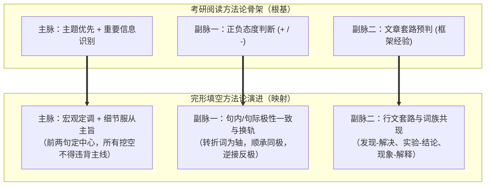
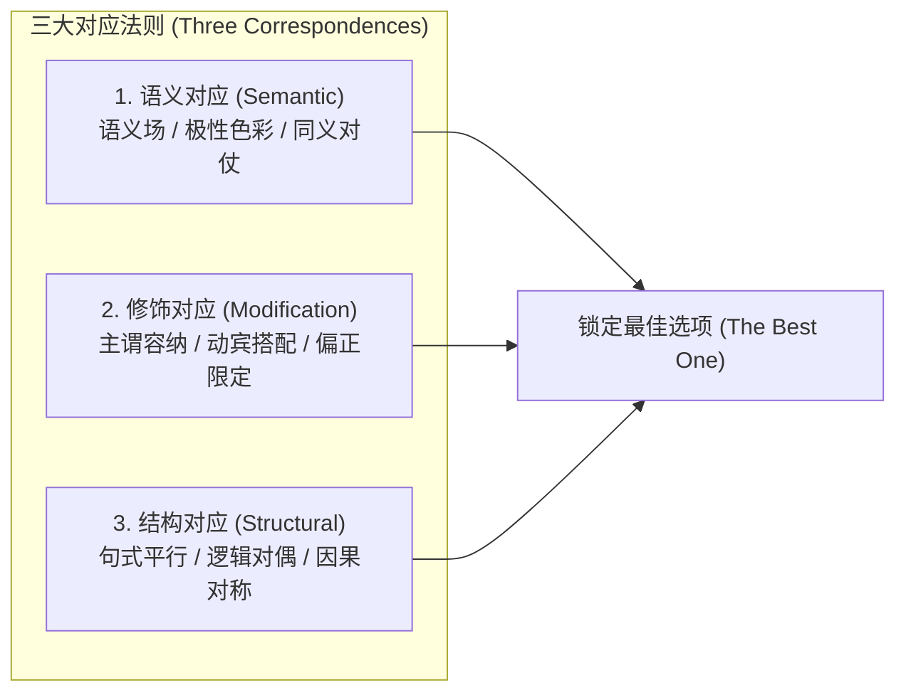
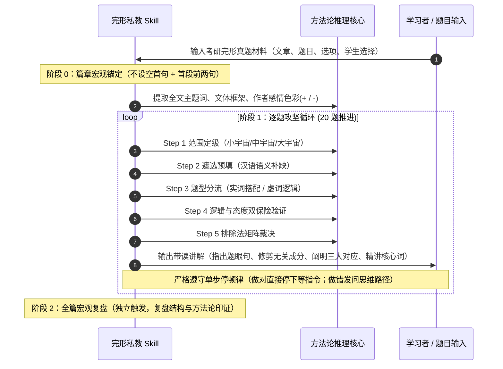
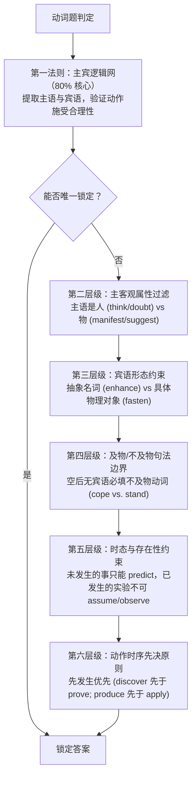
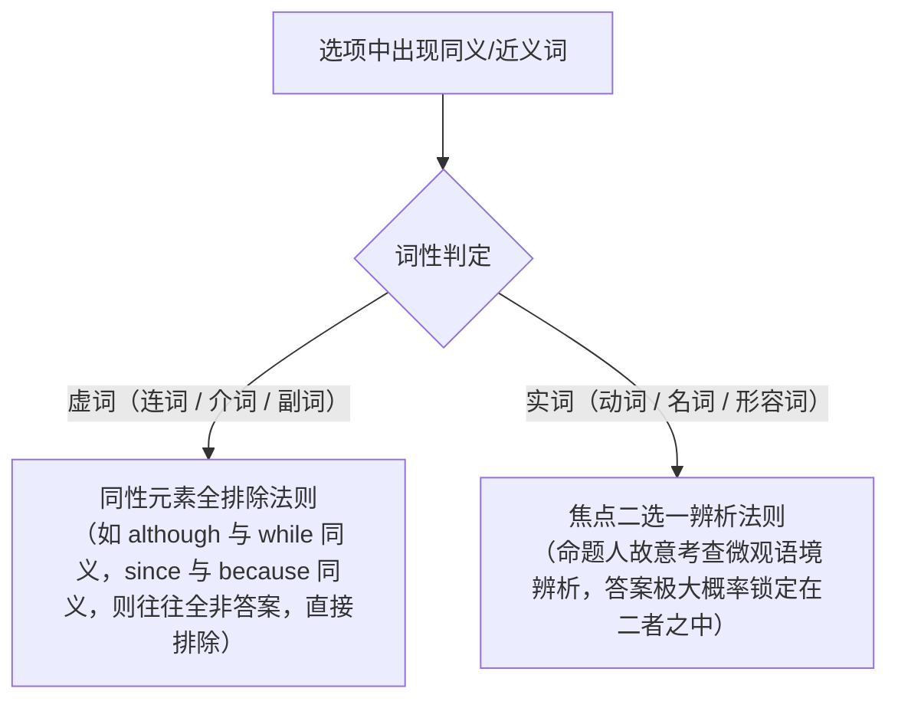
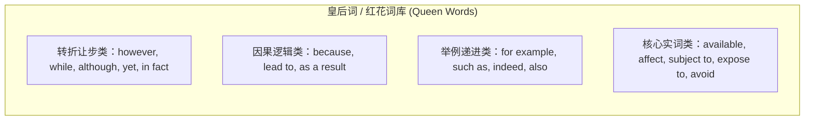
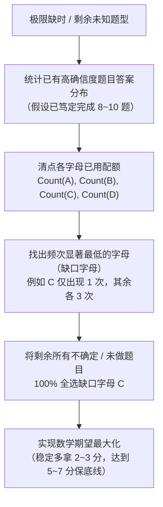

# 考研英语完形填空核心方法论 (Methodology for Cloze Test Skill)

> **文档性质声明**：本文档为 **AI Agent / Skill 专用执行规范与底层推理引擎**，非面向人类考生的入门教程。文档全面滤除“什么是动词/及物动词”等初级语法说明，仅保留经过历年考研真题验证的**核心解题方法论、讲解逻辑、线索定位拓扑、判别矩阵与统计学裁决算法**。

---

## 目录 (Table of Contents)
- [一、完形填空命题机理与宏观指导思想](#一完形填空命题机理与宏观指导思想)
  - [1. 考研阅读方法论在完形中的平移与重构](#1-考研阅读方法论在完形中的平移与重构)
  - [2. 完形文章的三大物理特征与出题规律](#2-完形文章的三大物理特征与出题规律)
  - [3. “最佳选项”裁决原则](#3-最佳选项裁决原则)
- [二、时空拓扑架构：三维宇宙与三大对应法则](#二时空拓扑架构三维宇宙与三大对应法则)
  - [1. 三维宇宙解题拓扑（线索定位域）](#1-三维宇宙解题拓扑线索定位域)
  - [2. 三大对应法则（核心裁决机制）](#2-三大对应法则核心裁决机制)
  - [3. 语义范畴放缩原则](#3-语义范畴放缩原则)
- [三、标准做题与带读讲解执行流水线](#三标准做题与带读讲解执行流水线)
  - [1. 阶段 0：篇章宏观锚定（不设空首句 + 首段前两句）](#1-阶段-0篇章宏观锚定不设空首句--首段前两句)
  - [2. 阶段 1：逐空攻坚五步执行链（标准解题闭环）](#2-阶段-1逐空攻坚五步执行链标准解题闭环)
  - [3. 阶段 2：特殊解题与带读战术](#3-阶段-2特殊解题与带读战术)
- [四、分词性/分题型核心解题方法论](#四分词性分题型核心解题方法论)
  - [1. 动词题解题规范（占实词 80%）](#1-动词题解题规范占实词-80)
  - [2. 名词题解题规范](#2-名词题解题规范)
  - [3. 形容词与副词题解题规范](#3-形容词与副词题解题规范)
  - [4. 代词与虚词介词题解题规范](#4-代词与虚词介词题解题规范)
  - [5. 逻辑关系题解题规范（全题型最具可推导性）](#5-逻辑关系题解题规范全题型最具可推导性)
- [五、完形专属杀招与核心解题规律库](#五完形专属杀招与核心解题规律库)
  - [1. 复现原则（词汇与概念的镜像闭环）](#1-复现原则词汇与概念的镜像闭环)
  - [2. 同意分流原则（实词二选一，虚词同义皆排除）](#2-同意分流原则实词二选一虚词同义皆排除)
  - [3. 简单词优先原则](#3-简单词优先原则)
  - [4. 说明文/实验报告 50 场景词族与黑话体系](#4-说明文实验报告-50-场景词族与黑话体系)
  - [5. 少数派对比与二元对立人群法则](#5-少数派对比与二元对立人群法则)
  - [6. 正能量与常识底线原则](#6-正能量与常识底线原则)
- [六、红花绿叶词库与逻辑双保险验证机制](#六红花绿叶词库与逻辑双保险验证机制)
  - [1. 皇后词（红花词）高频命中库与触发条件](#1-皇后词红花词高频命中库与触发条件)
  - [2. 宫女词（绿叶词）高频陪考排除库](#2-宫女词绿叶词高频陪考排除库)
  - [3. 逻辑代入双保险原则（严防反押题反套路）](#3-逻辑代入双保险原则严防反押题反套路)
- [七、干扰项特征与十大排除矩阵](#七干扰项特征与十大排除矩阵)
  - [1. 十大标准排除法矩阵](#1-十大标准排除法矩阵)
  - [2. 错题归因定位准则](#2-错题归因定位准则)
- [八、选项统计学概率平衡与极限保底机制](#八选项统计学概率平衡与极限保底机制)
  - [1. 5A-5B-5C-5D 宏观平衡约束](#1-5a-5b-5c-5d-宏观平衡约束)
  - [2. 相邻不连三与局部离散约束](#2-相邻不连三与局部离散约束)
  - [3. 极限保底算法（残局补齐与穷尽测算）](#3-极限保底算法残局补齐与穷尽测算)

---

## 一、完形填空命题机理与宏观指导思想

### 1. 考研阅读方法论在完形中的平移与重构
考研完形填空（Use of English）绝非零散词汇填空，其实质是**高密度带空阅读理解**。其命题思想完全遵循考研英语阅读方法论的“一主二辅”骨架：

- **方向比速度重要**：未明全文主旨与情感基调（+ 积极支持 / − 消极批判）前，严禁动手选词。做每一道题必须胸怀大局，拒绝孤立猜词。
- **细节服从主旨**：完形填空是阅读理解的微观映射。当两个选项在局部语法均说得通时，**唯一裁决标准是“哪个选项与全文/段落中心主题契合度最高”**。
- **重要信息三特征的微观呈现**：
  1. *重要位置*：首段首句（全文中心）、各段首句（段落分论点）、段尾总结句。
  2. *重要标志*：逻辑转折词（but, however, while, yet）、因果词（so, because, lead to）、比较对比结构。
  3. *重复现象*：词汇复现、同义近义替换、反义对比对仗。

### 2. 完形文章的三大物理特征与出题规律
1. **篇幅短小，密度极高**：全文通常 240~280 词，共设 20 空，平均每 4~15 词设一空。
2. **首段首句绝对不设空**：第一句是命题人预留的“破案钥匙”，100% 承担全文主旨、写作对象与基调的定义功能。
3. **结构高度固定，总分坚持到底**：
   - **全文结构**：几乎全部为“总-分”或“总-分-总”。前两句必然交代全文中心。
   - **段落结构**：除第一段外，各段段首句通常是该段的中心总括句；段内展开为具体论据/事例。
   - **段际关系**：段落之间若出现逻辑关系题，**80% 倾向于考查对比/转折**（因为前后段若无视角分歧或进阶，则无需分段）；其余 20% 为递进或承接展开。

### 3. “最佳选项”裁决原则
- **考研选的是 The Best One，而非 The Only Correct One**：命题人设置的干扰项在语法或字面翻译上往往“也能通”，但正确选项必然在**语义饱和度、论证逻辑闭环、行文色彩一致性、概念搭配范畴**上达到最优。
- 拒绝抬杠与病态假设：不以极罕见的特殊语境（如科幻、极端个案）为准，完全依循主流学术说明文与客观正能量常识。

---

## 二、时空拓扑架构：三维宇宙与三大对应法则

### 1. 三维宇宙解题拓扑（线索定位域）
完形填空的命题线索分布在三个不同维度的信息场域内。Skill 必须根据空所属场域，调配相应的搜索视窗：

| 宇宙层级 | 覆盖范围 | 考查题量占比 | 核心解题抓手 | 典型题眼特征 |
| :--- | :--- | :--- | :--- | :--- |
| **小宇宙 (Microcosm)** | **本句之内** (句内主谓宾定状补) | **约 10~12 题** (占比约 55%~60%) | 动宾搭配、主谓相容、介宾固定搭配、前置/后置定语修饰限制、及物/不及物句法边界。 | 空格两端存在强限定词（如及物动词缺宾语、名词后接限定性定语从句）。 |
| **中宇宙 (Mesocosm)** | **句际之间** (相邻上下句) | **约 6~7 题** (占比约 30%~35%) | 句间逻辑关系词（转折/因果/并列）、指代代词回溯、前后语义极性对仗、语意顺承延伸。 | 句首副词/连词空、主谓间插入语逻辑词、句子缺少上文语境无法判定具体动作。 |
| **大宇宙 (Macrocosm)** | **段际与全篇** (跨段/首尾呼应) | **约 1~2 题** (占比约 5%~10%) | 段首主旨句空格、全文核心态度总括、段际对比转换、深层概念复现。 | 孤立读该段完全无法确定，唯有依赖全文核心主旨或首段前两句方能秒杀。 |

### 2. 三大对应法则（核心裁决机制）
任何空格的成立，在考研命题标准中必须满足以下三大对应之一或其组合：

#### (1) 语义对应 (Semantic Correspondence)
- **内涵一致与褒贬同极**：好人干好事（积极态度对应正向动词/形容词），坏人干坏事；若出现好人干坏事，必有转折标志词作为反转轴。
- **语义场共现**：同一场景下的专属词汇聚集。例如在导航/迷路语境中，*woods, forest, compass, navigate, tracks, gaps, find a way out* 互为语义支撑；在疾病语境中，*flu, epidemic, addict, mental disorders, symptoms* 互为支撑。
- **概念复现**：前文出现的名词/动词，在后文以同义词、近义词、上义词或原词形式再现。

#### (2) 修饰对应 (Modification Correspondence)
- **非泛义搭配，而是自然语言核心相容**：
  - *主谓相容*：人才能思考（think, doubt, intend）、物只能呈现（manifest, demonstrate, suggest）。
  - *动宾相容*：抽样动词配抽象名词（enhance quality vs. fasten seatbelt）。
  - *偏正相容*：形容词对名词的修饰必须符合生活常识与专业语境（frequent hugs 带来 fewer *symptoms* 而非 errors）。

#### (3) 结构对应 (Structural Correspondence)
- **平行对等律**：由 *and, or, as well as, not only... but also...* 连接的结构，前后成分在词性、语法形态、语义极性上必须完全对等。
- **对偶对比律**：由 *while, whereas, on the one hand... on the other hand...* 引导的对比结构，左右两翼必须形成“反义词对”或“极性翻转”。
- **因果/条件对偶**：左侧为前提/原因，右侧为必然导向的结果，结构严格对称。

### 3. 语义范畴放缩原则
- **拒绝狭隘字典定义，提取词义核心内核**：
  - 例：`aid` 不仅局限于“医疗急救”，核心内涵放缩为“提供帮助/扶持（help/assist）”；
  - 例：`break` 作名词不仅指“打破/休息”，核心内涵放缩为“裂口/中断（gap/discontinuity）”；
  - 例：`address` 作动词不仅指“写地址/演说”，核心内涵放缩为“处理/应对/解决（solve/deal with）”；
  - 例：`moderate` 作动词不仅指“中庸”，核心内涵放缩为“减缓/平抑（ease/reduce）”。
- **Skill 讲解与推导规范**：当选项看似生硬时，向学生明确展示该词从“字典狭义”到“语境泛化核心”的放缩推导过程，消解生硬感。

---

## 三、标准做题与带读讲解执行流水线

### 1. 阶段 0：篇章宏观锚定（不设空首句 + 首段前两句）
收到篇章后，立即执行以下判定，作为后续 20 题的裁决大宪章：
1. **文体识别**：
   - *科学实验/研究报告说明文*：抓“研究对象 + 研究结论”。过程可略读，结论为核心。
   - *社会现象/问题解决类议论文*：抓“现状问题（通常负向）+ 解决方案（通常正向）”。
   - *新旧事物对比说明文*：新事物优越性为重点，新旧长期共存。
2. **全文主题词与情感极性**：
   - 提取首句的主谓宾核心，标定全局态度色彩（+ 赞许 / − 担忧质疑 / 0 客观中立）。
3. **宏观预测**：根据首句判定后文必定出现的内容板块（如提出问题后，后文必有成因分析或应对举措）。

### 2. 阶段 1：逐空攻坚五步执行链（标准解题闭环）
对每一道题，按以下标准化程序推导与输出：

- **Step 1：范围定级（定义线索搜索域）**
  - 判断该空是由本句（小宇宙）、上下句（中宇宙）还是段落/全文主旨（大宇宙）裁决。
- **Step 2：遮选预填（汉语代入法）**
  - **关键防御机制**：严禁直接看 ABCD 选项！四个选项同时输入会造成中英文匹配偏差与“看哪个都顺”的思维陷阱。
  - 遮住选项，通读题眼句，依据上下文语义在空格处用汉语补出一个精准的语义核心词。
- **Step 3：题型分流与特征比对**
  - 判定词性（动词、名词、形容词、副词、连词/介词），激活对应的专用规则库。
  - 将预填的汉语核心意图与四个选项进行语义范畴匹配。
- **Step 4：逻辑与态度双保险验证**
  - 检查候选词是否满足前后感情色彩一致性（+/- 符号法则）。
  - 若候选词为高频皇后词（如 however, while, because），必须代入检验句际逻辑是否真正成立，杜绝盲目押宝。
- **Step 5：排除法矩阵裁决**
  - 运用十大排除矩阵（无中生有、过度引申、反常识、因果倒置等）斩断干扰项，锁定唯一最佳选项。

### 3. 阶段 2：特殊解题与带读战术
#### (1) 长难句/多空逆向突破战术（倒序做题法）
- **适用场景**：一句话中出现两个或两个以上空格（如句首设空且句尾也设空），或者句子包含复杂后置定语从句/状语从句。
- **执行规则**：
  - 主句往往与全局产生复杂联系，而从句信息相对独立完整。
  - **从后往前倒着做**：先做后置从句中的空，理清从句的具体语境和修饰对象；
  - 借后置从句补全的明确线索，反推主句的主干空。

#### (2) 带读定位段的修剪技术（向学生展示“删繁就简”）
- Skill 在输出带读过程时，必须明确示范**“哪句是题眼句必须精读，哪句是冗余细节可以跳读”**：
  - *必须保留精读*：段首总括句、含逻辑转折词的半句、主谓宾核心骨架、紧随空格的定语从句。
  - *果断剔除跳读*：两个逗号之间的长插入语、具体数字/年份/专有名词列举、For example 引出的次要事例细节、修饰完整的让步从句。

---

## 四、分词性/分题型核心解题方法论

### 1. 动词题解题规范（占实词 80%）
动词是全篇骨架，绝大多数动词在句中充当谓语。解动词题必须按以下层级推进：

1. **主谓宾逻辑网（第一法则，覆盖率 80%+）**：
   - 动词作为谓语，其语义完全由**主语（动作发出者）**与**宾语（动作承受者）**决定。
   - 提取主语核心名词与宾语核心名词，代入四个选项，排除违背常理、违背逻辑的动作。
2. **主语人/物属性约束**：
   - *必须为人作主语*：think, believe, doubt, intend, claim, contend, regard, notice, require 等（具备主观意识与意图）。
   - *物作主语*：manifest, show, suggest, demonstrate, prove, indicate 等。电脑/数据不能 doubt 或 challenge。
3. **宾语抽象/具体形态约束**：
   - 抽象名词宾语：enhance (efficiency/reputation), cultivate, foster, nurture。
   - 具体物理对象宾语：fasten, label, fold, tie 等。
4. **及物 (vt.) vs. 不及物 (vi.) 句法边界**：
   - 空后**无宾语或直接接句号/介词**：100% 选不及物动词（如 *cope* with; things *stop*）；
   - 及物动词缺失宾语在语法上直接判死刑。
5. **时态与存在性约束**：
   - *未发生/将来状态*：宾语若为“将来时间、趋势、预期”，谓语动词必为 *predict, expect, foresee*，绝不能选 *discover, show, prove*（未发生之事不可“发现”或“证明”）。
   - *已完成/已发表的实验研究*：不可填 *assume, imagine, observe*（已在期刊上描述发表的实验是既成事实，只能 *consider, review*）。
6. **动作时序先决原则**：
   - 当多个动词在语境中均有一定道理时，**按事件自然发展的时间逻辑，先发生者优先**：
     - 先 *discover*（发现），后 *prove*（证明）或 *remember*（记住）；
     - 先 *produce*（产生），后 *apply*（应用）或 *maintain*（维持）；
     - 先 *introduce*（引入），后 *develop*（发展）或 *popularize*（普及）。

### 2. 名词题解题规范
名词在句中多充当主语、宾语或表语。解题抓手为**“周围限定修饰成分”**：

1. **定语与同位语修饰优先律（覆盖率 70%+）**：
   - 名词极少孤立出现，其前方必有形容词/名词前置定语，其后方必有定语从句、分词短语或同位语（尤其是冒号后的解释说明）。
   - **解题公式**：空格所填名词 = 后置定语/同位语的核心内涵概括。
     - 例：a `shelter` [that will give them three meals and a place to sleep]；
     - 例：the `diet` [that is high in fiber and low in processed food]；
     - 例：this universal protection sense sent a `message`: [Do not approach me]。
2. **句法成分倒推律**：
   - 名词充当主语 -> 看谓语 + 宾语；
   - 名词充当宾语 -> 看主语 + 谓语（动宾逻辑）；
   - 名词充当表语（S + be/become + 空格） -> **主语是唯一线索**：
     - 若主语是实体名词：*The newspaper became the `medium`*（报纸是媒介）；
     - **若主语是指代词 (this, that, it)**：**必须立即前溯上一句的核心陈述**！*I am dropping weight constantly. This is a `sign` that...*（体重不断减轻是一种迹象）。
3. **概念层次与包容度法则**：
   - 当选项中出现多个看似相关的名词时，比较其**抽象概括等级**：
   - 能同时容纳后文并列列举对象的上位概念优先。例如自由（liberty）与财产（property）并列时，只能归入 `concept`（概念），而不能归入 `theory`（理论，财产不是理论）或 `conception`（社会构想）。

### 3. 形容词与副词题解题规范
1. **情感极性绝对吻合（+/- 法则）**：
   - 形容词/副词是全篇承载作者态度与语义褒贬的最强载体。
   - 题眼句若无转折，所填形容词极性必须与全局及段落基调完全同向；若有转折词，则极性反转。
2. **修饰对象本质属性相容**：
   - 形容词看修饰的名词（偏正短语），副词看修饰的动词/整句。
   - 排除属性冲突与不合常理的组合（如严重的失败/serious failure 在学术语境中远不如重大失败重大错误，严重的通常修饰 *symptoms, disease, consequence*）。
3. **比较级与反义对仗**：
   - 句中出现比较级（more, fewer, less）或反义结构（rather than, instead of）时，空格必定与对比基准项构成反义或程度递进。
     - 例：*frequent hugs* 对应 *fewer `severe` symptoms*。

### 4. 代词与虚词介词题解题规范
1. **代词严密前溯律**：
   - 代词（it, they, this, these）指代对象必然出现在前 1~2 句中。
   - 严格核验单复数、人称属性、概念一致性。
2. **介词搭配习惯与逻辑功能**：
   - 介词本质是表逻辑关系的微型虚词：*subject `to`*（遭受/从属于）；*focus `on`*；*contribute `to`*；*against*（反对/抗衡）；*beyond*（超出）。

### 5. 逻辑关系题解题规范（全题型最具可推导性）
逻辑关系题考查句间或从句与主句的粘合，分为三大实操法则：

#### (1) 对应成分对等审视律
- 填入逻辑词前，**先看逻辑词后面接的是什么**：
  - 后接名词/名词短语 -> 前面只看对应名词/短语（如 *signals* `such as` *the smell of smoke*）；
  - 后接完整句子 -> 前面必须调出前一句完整句子进行宏观对立/顺承推演。

#### (2) 插入语位置复原律
- 当逻辑词位于主语和谓语之间（用两逗号隔开，如 *A, `however`, B*）时，**该词在逻辑功能上 100% 属于句首**！
- 必须将该词提取至句首，审视整句与上一句之间的承接关系。

#### (3) 核心六大逻辑关系判别矩阵：

| 逻辑类型 | 核心真题标志词 | 语义判别依据 | 考查高频规律 |
| :--- | :--- | :--- | :--- |
| **对比/转折** | *however, but, while, yet, in fact, whereas, conversely, on the contrary* | 前后语义极性翻转，或同一维度的反向对立（黑 vs. 白，难 vs. 易，增 vs. 减）。 | **段首题第一优先选项（80%）**；*while* 表对比极高频；*in fact* 表事实转折。 |
| **让步** | *although, though, even if, despite, in spite of* | 退一步承认，但主句重心在后；弱对比。 | *although = though = while*，同义出现时互斥排除。 |
| **因果** | *because, since, as, so, thus, therefore, lead to, result from* | 前因后果，或前果后因。两件事存在物理/逻辑必然性。 | 区分原因词 (*because, since*) 与结果词 (*so, thus*)，果因倒置直接排除。 |
| **并列/递进** | *and, also, besides, indeed, furthermore, moreover, as well as* | 同一方向追加信息；*indeed* 表递进强调；*besides* 表同向补充。 | 前后极性必须同正或同负；段首无对比时优先选递进。 |
| **举例/包容** | *for example, for instance, such as* | 前面大概念/总括句，后面小概念/具体实例（具有包容性）。 | 前后若是名词包容（水果-苹果），必为 *such as*；前后是句子论证必为 *for example*。 |
| **条件** | *if, unless, provided that, as long as* | 假设前提。*unless = if not*（除非）。 | *provided that = if*，出现常互斥排除。 |

---

## 五、完形专属杀招与核心解题规律库

### 1. 复现原则（词汇与概念的镜像闭环）
- 考研完形文章在 250 词内反复围绕一个核心主题论述，语言高度凝练。**同一概念在文中多次出现时，其提法与搭配必须互为照应**：
  1. *原词复现*：前文出现的关键词在后文原样重现。
  2. *同义替换复现*：如前文用 *affect*，后文用 *influence*；前文用 *gap*，后文用 *break*；前文用 *define*，后文用 *describe*。
  3. *反义对称复现*：如前文 *high BMI*，后文通过 *while* 对应 *low BMI*。

### 2. 同意分流原则（实词二选一，虚词同义皆排除）
命题人在设置选项同义词时的心理分化机制：

### 3. 简单词优先原则
- **考研完形是基础性测试，考查常用词的精准用法，非偏难怪词汇赛跑**。
- 正确选项 90% 以上属于考研大纲最基础、最核心的 2000 常用词（如 *common, simple, number, notice, process, lead*）。
- 若选项中出现极其生僻古怪的专有词汇或超纲词（如非大纲核心名词），绝大多数仅为陪考干扰项（宫女词），大胆优先考虑常见词。

### 4. 说明文/实验报告 50 场景词族与黑话体系
考研完形 70% 以上为说明文与实验研究报告。这类文章有极固定的套路词族：

| 模块阶段 | 核心场景词族（高频正确项） | 命题语境功能 |
| :--- | :--- | :--- |
| **提出目的 / 发现问题** | *raise (questions/concerns), address (issues), predict, difficulty, doubt, challenge* | 确立研究缘起或社会痛点 |
| **实验过程 / 样本追踪** | *conduct (experiments), compare, measure, track, test, subject to, expose to, affect, connection* | 阐述科研操作，多为客观中性词 |
| **分析论证 / 现象呈现** | *depict, describe, reveal, indicate, demonstrate, manifest, tendency, shape, sign* | 展示数据与行为表象 |
| **得出结论 / 影响产出** | *lead to, consequence, outcome, evidence, conclude, conclusive, turn out, produce, available, normal* | 宣布实验最终判定，主旨落脚点 |

### 5. 少数派对比与二元对立人群法则
- 考研文章作者常代表深刻、客观的学术少数派视角，批判大众流行偏见。
- 文中若出现人群对照结构：
  - `Some people ... others ...`
  - `The majority ... only a few ...`
  - `Most leaders ... some critics ...`
- **两部分人群的动作、观点必然构成转折对立**，句间必须选转折对比词（*while, in contrast, however*），实词填空必然构成反义词对。

### 6. 正能量与常识底线原则
- 考研真题选材具备严肃的国家级考试政治与伦理底线：
  - **绝对正能量**：不得歧视肥胖、疾病、弱势群体；提倡身心健康、社会交往、理性科研、环境保护。
  - **常识契合**：符合正常人类行为规律（人不会无故咬狗，生病不会使人开心，减肥不会倡导高热量加工食品）。凡违背人伦常识与社会正能量的选项直接排除。

---

## 六、红花绿叶词库与逻辑双保险验证机制

### 1. 皇后词（红花词）高频命中库与触发条件
历年真题中出现时入选概率极高（≥85%）的特征词汇：

### 2. 宫女词（绿叶词）高频陪考排除库
历年真题中频繁作为干扰项陪跑、极少作为正确答案（排除率 ≥90%）的词汇：
- **独立副词句首使用**：*instead*（独立在句首无 of 时极少对，*instead of* 才是常见考点）。
- **极端绝对副词**：*only, exclusively, uniquely*（除非原文极其明确，否则说话太满必错）。
- **古板/罕见介词短语**：*in case, lest, for fear that*（以防万一类在近年真题极少入选）。
- **泛指关于类**：*as to, as for, in reference to, with respect to, with regard to*（多用于作文，完形极少选）。
- **假因果/限制词**：*since*（作“自从”解时几乎不选，作“因为”解时偶选）；*now that*（既然）；*if only*（要是...就好了）。

### 3. 逻辑代入双保险原则（严防反押题反套路）
> [!CAUTION]
> **绝对禁止盲目无脑秒选红花词**！命题组在近几年真题中频繁引入“反套路反押题”设计（如选项中同时出现 *however* 与 *while*，或利用 *for example* 制造假举例陷阱）。
> **双保险执行令**：识别出红花词后，**必须强制执行“语义代入验证”**——验证前后句是否真正具备该逻辑关系。唯有“红花词概率 + 逻辑关系验证通顺”同时满足，方可最终敲定。

---

## 七、干扰项特征与十大排除矩阵

### 1. 十大标准排除法矩阵
在解题决策中，遇到以下特征的选项，立即予以剔除：

| 排除法编号 | 干扰项类型 | 典型特征与判别标准 |
| :--- | :--- | :--- |
| **Rule 1** | **过度引申 / 臆断项** | 选项含义超出原文证据链（如原文只陈述“现象与客观事实”，选项引申到“解决办法或主观情绪”）。 |
| **Rule 2** | **因果倒置项** | 颠倒事件先后顺序或因果逻辑（如将“从成功中获得自信”反写为“获得自信才成功”）。 |
| **Rule 3** | **同义虚词通斥项** | 两个或三个虚词（连词/副词）含义完全一致，互为充要条件，必定双双/通通排除。 |
| **Rule 4** | **反常识 / 负能量项** | 违背客观科学常理、日常生活逻辑或传递不良价值观（如歧视、过度发泄、违法违规）。 |
| **Rule 5** | **主客观属性错位项** | 人物动词安插在无生命物上（如电脑 *doubt*），或抽象动词配具体实物。 |
| **Rule 6** | **及物性语法违背项** | 及物动词空后无宾语，或不及物动词后直接强跟宾语无介词过渡。 |
| **Rule 7** | **时态与存在性悖论项** | 对未来/未发生事件使用 *discover/prove*，对已完成既成事实使用 *assume/imagine*。 |
| **Rule 8** | **绝对化表述项** | 包含 *all, never, completely, exclusively, solely* 等无退路表述。 |
| **Rule 9** | **概念偷换与拼接项** | 将上文修饰 A 的定语嫁接到下文的 B 身上，拼凑原文碎片词汇制造视觉假象。 |
| **Rule 10** | **词形/词义混淆项** | 考查形近词或熟词僻义干扰（如混淆 *respectable* 与 *respective*，或死抓常用义忽略语境义）。 |

### 2. 错题归因定位准则
Skill 带读学生复盘错题时，严禁输出模棱两可的模糊评语，必须将学生的错误严格归入以下**三类根因**之一：
1. **视窗受限（宇宙定级错误）**：死抠本句，未看到相邻句甚至前段首句的核心提示。
2. **直觉先入为主（未执行遮选预填）**：直接看选项被干扰项带偏，产生中文“代入也通”的心理错觉。
3. **极性倒错（忽略转折与感情色彩）**：未能识别 *but, however, while* 等隐性转折导致的正负极性反转。

---

## 八、选项统计学概率平衡与极限保底机制

### 1. 5A-5B-5C-5D 宏观平衡约束
根据考研标准化测试命题规范，20 道题的答案选项在宏观上受到严格的统计学正态分布约束：
- **标准均分模型**：全卷 ABCD 四个字母的出现频次平均为 **5-5-5-5**。
- **允许波动阈值**：历年真题中，单个字母的出现下限极少低于 **4 个**，上限极少超过 **6 个**（极罕见情况下出现 7 个，但 100% 不会出现 8 个以上）。

### 2. 相邻不连三与局部离散约束
1. **相邻绝不连三**：试卷中绝不可能出现连续 3 道题答案为同一字母（如 AAA、CCC 必然判定为做题失误）。
2. **两连相同极低频**：全卷出现连续两道题答案相同（如 AA, BB）的次数通常仅有 **0~3 处**，其余 17~20 题均呈现离散分布。

### 3. 极限保底算法（残局补齐与穷尽测算）
当学生面临时间极度匮乏（如仅剩 3~5 分钟）或遇到多道死磕无法突破的难题时，Skill 应指导执行以下**“数学期望最大化补齐算法”**：

> ⚠️ **保底策略警示**：此算法仅作为考场应急与兜底决策工具。日常精读带读与训练，必须 100% 聚焦于前述**“三维宇宙拓扑 + 三大对应法则 + 五步执行链”**的逻辑硬实力构建。
